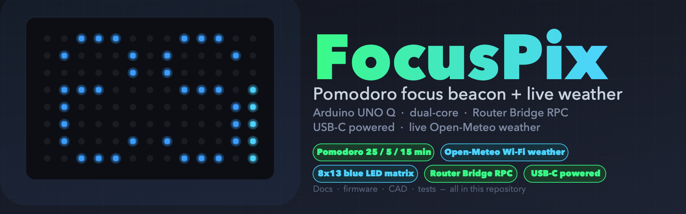

# FocusPix — a Pomodoro focus beacon on the Arduino UNO Q



FocusPix turns a **stock Arduino UNO Q** into a desktop focus beacon with **no extra
electronics — just the board, a USB-C power bank, and a printed case**. The on-board 8×13
blue LED matrix counts down your Pomodoro session, the four RGB LEDs give you a glanceable
status light (green = focus, blue = break, red flash = done), and the built-in Wi-Fi shows
**live local weather** as an icon + temperature.

- 25/5/15-minute Pomodoro with a long break after 4 sessions (configurable)
- Two large countdown digits + a live progress-bar column on the 8×13 matrix
- Open-Meteo weather: live icon + compact temperature readout
- RGB status LED (LEDs 1/2 on the MPU side) mirrored to STM32-side LED 3 via Router Bridge
- Dual-core: Python app (MPU QRB2210) drives the STM32U585 through the official
  `Bridge.call(...)` RPC — the matrix is drawn by the same Arduino-style core as any sketch
- Parametric, press-fit 3D-printed enclosure (no screws) verified against the official STEP

## How it works

```
  MPU QRB2210 (Wi-Fi)                 STM32U585
  ┌─────────────────────┐   Router    ┌──────────────────────┐
  │ app/main.py          │   Bridge    │ firmware/focuspix.ino │
  │ Pomodoro state       │  RPC over   │ RPC handlers:          │
  │ Open-Meteo fetch     │ ──────────► │  ping / matrix_show /  │
  │ frame rendering      │  Bridge.call│  matrix_clear / rgb_set│
  │ RGB LEDs 1/2 (GPIO)  │             │ LED matrix + RGB 3/4   │
  └─────────────────────┘              └──────────────────────┘
```

## Quick start

**1. Flash the firmware to the STM32 core**
Open `firmware/focuspix.ino` in the Arduino IDE, set the board to **UNO Q**, and upload. It
registers the Router Bridge RPC handlers and runs a self-test (matrix sweep + LED 3 blink)
when no host is connected.

**2. Copy the app to the MPU core**
Copy `app/` (main.py, fonts.py, config.json) to the UNO Q's internal filesystem (via
*Tools → MPU Files* in the IDE, or any Arduino_Python_Components workflow).

**3. Run it**
Run `main.py` on the MPU core (e.g. via the IDE's Python console / OpenMV-style workflow).
It uses the same app_utils `App`/`Bridge`/`Leds` API as every UNO Q Python project and
auto-services `provide_safe` callbacks.

**4. Power it**
The UNO Q is powered over USB-C. To run FocusPix standalone in its case, plug any standard
USB power bank into the front USB-C port (the case has a dedicated plug channel for the
cable). A right-angle cable keeps the footprint tidy.

**5. Try it without hardware**
```
.venv/bin/python tests/test_app.py     # 6 offline checks
.venv/bin/python app/main.py            # same logic, ASCII renders on console
```
The app detects the absence of the `arduino.app_utils` module and falls back to console
logging with ASCII frame output, so every feature is testable off-board.

## Configuration (`app/config.json`)

```json
{
  "focus_minutes": 25,
  "short_break_minutes": 5,
  "long_break_minutes": 15,
  "sessions_before_long_break": 4,
  "city": "Milan",
  "lat": 45.4642, "lon": 9.1900,
  "weather": { "refresh_minutes": 30, "show_seconds": 8 },
  "display": { "frame_refresh": 1.0, "blink": 1.0 }
}
```

## Display modes

| Phase | What you see | RGB status |
|-------|--------------|------------|
| Weather (8 s, on refresh) | WMO icon (cols 0–4) + compact temp (°C) | green (focus) / blue (break) |
| Countdown | Two 5×8 digits (MM) + vertical progress bar (col 12) | session color |
| Session end | Full-matrix 4 Hz flash for 2 s | red flash |

**One display at a time.** The matrix has exactly one screen (8×13 = 104 pixels), so the
weather and the countdown are **time-sliced, never shown together**. When a session starts
and the cached reading is older than `refresh_minutes`, the weather screen is shown first
for `show_seconds` (8 s); the Pomodoro clock keeps running underneath (wall-clock accurate),
then the countdown takes over at the correct remaining time. On boot, weather is always
shown first. This sequencing is pinned by `test_one_display_at_a_time`.

## Build the enclosure

```
.venv/bin/python enclosure/generate.py    # emits STEP/STL + runs geometry self-checks
```
Prints at 0.2 mm layer height, 2–3 walls, 20% infill, no supports. The lid presses into the
base via two bosses; the front USB-C notch passes a power-bank cable to the port. Full
geometry verification (hole probes, board-vs-case collision = 0 mm³) is logged in
`decisions.md`.

**Fusion 360:** run `enclosure/fusion/make_enclosure.py` in Fusion's Python console to import
the three STEP files and save an editable `FocusPix_enclosure.f3d`.

## Repository map

```
docs/header.svg|.png     project header graphic (scalable SVG + PNG render)
firmware/focuspix.ino      STM32 RPC server + self-test
app/main.py, fonts.py      MPU Python app (Pomodoro + weather + renderer), config.json
tests/test_app.py          6 offline tests (all green)
enclosure/config.py        parametric dimensions (source of truth)
enclosure/generate.py      CadQuery builder + checks + STEP/STL export
enclosure/out/             focuspix_base/lid/assembly .step + .stl
enclosure/fusion/          Fusion -> .f3d helper
bom.csv, bom.md            BOM (UNO Q + power bank + ~40 g filament, ~US $55)
APPLICATION.md             contest entry (items a–f)
decisions.md               engineering log
reference/                 official UNO Q STEP, PDFs, drill/CAD files
```

## License
MIT — see LICENSE.
